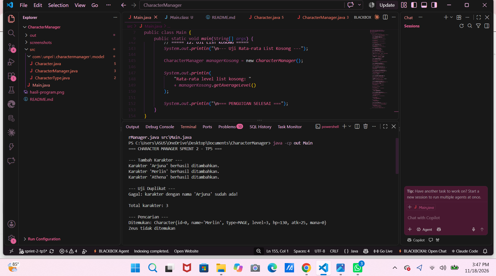
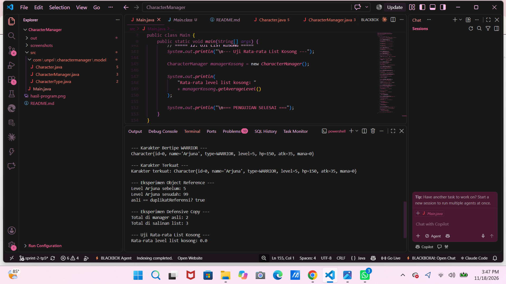

# Character Manager — TP5 (Java Visual SIH-6406)

## 1. Deskripsi
Character Manager merupakan aplikasi berbasis Java untuk mengelola data karakter game. Proyek ini dikembangkan sebagai bagian dari tugas TP5 mata kuliah Java Visual SIH-6406.

Pada Sprint #2, aplikasi dikembangkan dengan menerapkan konsep Object-Oriented Programming (OOP), khususnya Object Reference, Method Overriding, ArrayList, dan Encapsulation.

## 2. Fitur Utama
- Menambahkan karakter ke dalam daftar.
- Mencegah penambahan karakter dengan nama duplikat.
- Mencari karakter berdasarkan nama.
- Menghapus karakter berdasarkan nama.
- Menghitung total karakter.
- Menampilkan seluruh karakter.
- Mengembalikan salinan daftar menggunakan Defensive Copy.
- Menghitung rata-rata level karakter.
- Mencari karakter berdasarkan tipe (CharacterType).
- Mencari karakter dengan Attack Power tertinggi menggunakan findStrongest().

## 3. Struktur Folder
```text
CharacterManager/
├── src/
│   ├── Main.java
│   └── com/
│       └── unpri/
│           └── charactermanager/
│               └── model/
│                   ├── Character.java
│                   ├── CharacterType.java
│                   └── CharacterManager.java
└── README.md
```

## 4. Penjelasan Custom Analytic Feature
Fitur tambahan yang dikembangkan adalah findStrongest().

Method ini digunakan untuk mencari karakter dengan nilai Attack Power tertinggi dari seluruh karakter yang tersimpan di dalam CharacterManager.

Jika daftar karakter kosong, method akan mengembalikan null. Dengan fitur ini, pengguna dapat mengetahui karakter terkuat tanpa harus mencari dan membandingkan Attack Power secara manual.

## 5. Hasil Pengujian Program
Program telah diuji dengan beberapa skenario:
- Penambahan karakter.
- Penolakan nama karakter duplikat.
- Pencarian dan penghapusan karakter.
- Perhitungan rata-rata level.
- Pencarian karakter berdasarkan tipe.
- Pencarian karakter terkuat.
- Pengujian Object Reference.
- Pengujian Defensive Copy.
- Pengujian rata-rata pada daftar kosong.

**Screenshot hasil pengujian:**





## 6. Identitas Mahasiswa
- Nama: Triyani Vianny
- NIM: 253303621278
- Mata Kuliah: Java Visual SIH-6406
- Tugas: TP5 — Character Manager Sprint #2
- Tanggal: 18 November 2026

## 7. Link Google Docs
https://docs.google.com/document/d/1FD08w44BXL_JIl6FOT5UnjX6Tw4e-4wPLTNIua4mxMQ/edit?usp=sharing
