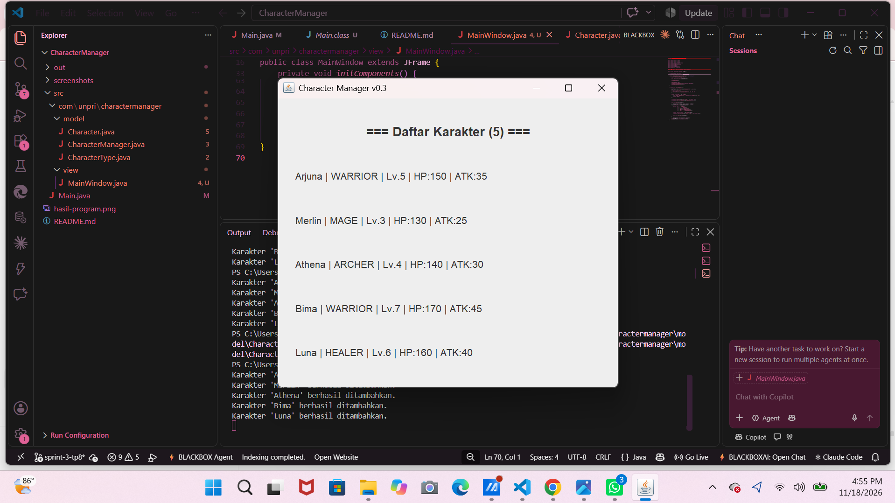
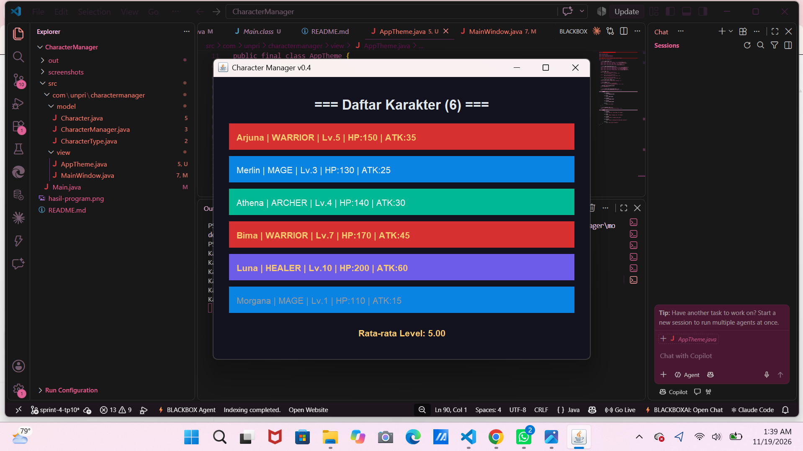

# Character Manager – Sprint 4 (TP10)

## Theming, Properti Komponen & Analisis MVC

**Mata Kuliah:** Java Visual  
**CPMK:** 2  
**SCPMK:** 4  
**Sprint:** 4  
**Tugas:** TP10 – Character Manager Sprint #4

---

## 1. Deskripsi Proyek

Character Manager merupakan aplikasi berbasis Java yang dikembangkan menggunakan konsep Object-Oriented Programming (OOP) dan Graphical User Interface (GUI) dengan Java Swing.

Pada Sprint 4 ini, aplikasi dikembangkan dari versi 0.3 menjadi versi 0.4. Pengembangan berfokus pada penerapan tema visual menggunakan class AppTheme, pengaturan properti komponen Swing, serta pemahaman pemisahan tanggung jawab berdasarkan prinsip Model-View-Controller (MVC).

Class AppTheme digunakan untuk mengelola warna, font, border, dan warna kartu berdasarkan role karakter. Tampilan aplikasi juga diperbarui agar lebih konsisten dan mudah digunakan.

## 2. Fitur yang Dikembangkan

1. Membuat class AppTheme.java pada package view.
2. Mengatur warna utama dan warna teks aplikasi.
3. Memberikan warna kartu berbeda berdasarkan role karakter.
4. Menggunakan tiga konstanta font.
5. Mengatur border melalui AppTheme.
6. Menggunakan pack() untuk menyesuaikan ukuran jendela.
7. Menampilkan enam karakter dengan role dan level yang bervariasi.
8. Memberikan highlight emas dan tebal pada karakter dengan level minimal 5.
9. Menyimpan batas level tinggi dalam konstanta HIGH_LEVEL_THRESHOLD.
10. Menambahkan tooltip dan properti enabled pada kartu karakter.
11. Mempertahankan fitur perhitungan rata-rata level.

## 3. Implementasi AppTheme

Class AppTheme.java dibuat pada package:

`com.unpri.charactermanager.view`

Class ini bertanggung jawab mengatur tampilan aplikasi secara terpusat.

### A. Warna Berdasarkan Role

| Role | Warna |
|---|---|
| WARRIOR | Merah |
| MAGE | Biru |
| ARCHER | Hijau |
| HEALER | Ungu |

Warna tersebut diterapkan menggunakan method colorFor(CharacterType type). Method ini menentukan warna kartu berdasarkan tipe karakter.

### B. Font

AppTheme menyediakan tiga konstanta font:

- FONT_TITLE: SansSerif tebal ukuran 22.
- FONT_BODY: SansSerif normal ukuran 14.
- FONT_MONO: Monospaced normal ukuran 13.

### C. Border

AppTheme menyediakan CARD_BORDER menggunakan BorderFactory.createEmptyBorder() untuk mengatur jarak bagian dalam kartu karakter.

## 4. Mini-Challenge – Highlight Level Tinggi

Karakter dengan level minimal 5 akan mendapatkan warna teks emas dan gaya font tebal.

Batas level tersebut disimpan dalam konstanta:

`HIGH_LEVEL_THRESHOLD = 5`

Karakter dengan level di bawah 5 menggunakan teks putih dan font normal.

Penggunaan konstanta membuat pengaturan batas level lebih mudah diubah dan menghindari penulisan angka yang sama secara berulang.

## 5. Dua Properti Tambahan

### A. Tooltip

Properti setToolTipText() digunakan untuk menampilkan informasi tambahan ketika kursor diarahkan ke kartu karakter.

Informasi yang ditampilkan meliputi role, HP, dan ATK. Properti ini membantu pengguna melihat informasi karakter tanpa membuat tampilan utama terlalu penuh.

### B. Enabled

Properti setEnabled(false) digunakan untuk menandai karakter dengan level 1 sebagai karakter terkunci.

Properti ini memberikan tampilan berbeda pada karakter yang masih berada di level awal. Tooltip khusus juga ditambahkan untuk menjelaskan kondisi karakter tersebut.

## 6. Data Karakter

Pada Sprint 4, aplikasi menampilkan enam karakter dengan variasi role dan level.

| Nama | Tipe | Level |
|---|---|---:|
| Arjuna | WARRIOR | 5 |
| Merlin | MAGE | 3 |
| Athena | ARCHER | 4 |
| Bima | WARRIOR | 7 |
| Luna | HEALER | 10 |
| Morgana | MAGE | 1 |

Perhitungan rata-rata level:

(5 + 3 + 4 + 7 + 10 + 1) / 6 = 5.00

## 7. Hasil Pengujian

### A. Sebelum Pengembangan – Versi 0.3

Pada versi 0.3, tampilan karakter masih sederhana dan belum menggunakan warna khusus berdasarkan role.



### B. Setelah Pengembangan – Versi 0.4

Pada versi 0.4, setiap kartu karakter memiliki warna sesuai role. Karakter dengan level minimal 5 ditampilkan dengan teks emas dan tebal. Tooltip dan properti enabled juga telah diterapkan.



### C. Ringkasan Pengujian

| Komponen yang Diuji | Hasil |
|---|---|
| AppTheme | Berhasil |
| Warna kartu berdasarkan role | Berhasil |
| Highlight level minimal 5 | Berhasil |
| Tooltip informasi karakter | Berhasil |
| Karakter level 1 nonaktif | Berhasil |
| Rata-rata level | Berhasil |
| Kompilasi program | Berhasil |

## 8. Analisis MVC

Pengaturan warna, font, border, dan properti visual ditempatkan pada layer View karena berkaitan dengan bagaimana informasi ditampilkan kepada pengguna.

Class Character pada Model bertanggung jawab merepresentasikan data dan karakteristik karakter, bukan mengatur tampilan antarmuka.

Dengan memisahkan tanggung jawab tersebut, perubahan tema aplikasi dapat dilakukan tanpa mengubah struktur Model. Penggunaan AppTheme juga membuat pengaturan tampilan lebih terpusat, konsisten, dan mudah dipelihara.

## 9. Struktur Program

```text
CharacterManager/
│
├── src/
│   ├── Main.java
│   │
│   └── com/
│       └── unpri/
│           └── charactermanager/
│               ├── model/
│               │   ├── Character.java
│               │   ├── CharacterType.java
│               │   └── CharacterManager.java
│               │
│               └── view/
│                   ├── MainWindow.java
│                   └── AppTheme.java
│
├── screenshots/
│   ├── tp10-sebelum-v03.png
│   └── tp10-sesudah-v04.png
│
└── README.md
```

## 10. Laporan Google Docs

Link laporan Google Docs TP10:

**Akan ditambahkan setelah dokumen analisis TP10 selesai dibuat.**

Nama dokumen:

`JavaVisual_TP10_[NIM]_[Nama]`

## 11. Kesimpulan

Melalui Sprint 4 TP10, aplikasi Character Manager berhasil dikembangkan dari versi 0.3 menjadi versi 0.4 dengan penerapan tema visual terpusat melalui AppTheme.

Aplikasi mampu menampilkan kartu karakter dengan warna berdasarkan role, memberikan highlight emas pada karakter dengan level minimal 5, serta menggunakan tooltip dan properti enabled sebagai fitur tambahan.

Pengembangan ini juga memperkuat pemahaman mengenai properti komponen Swing dan prinsip MVC, khususnya pentingnya memisahkan tanggung jawab Model dan View.

---

**Repository GitHub:**  
https://github.com/yanicantik16/JavaVisual-253303621278

**Branch:** `sprint-4-tp10`
