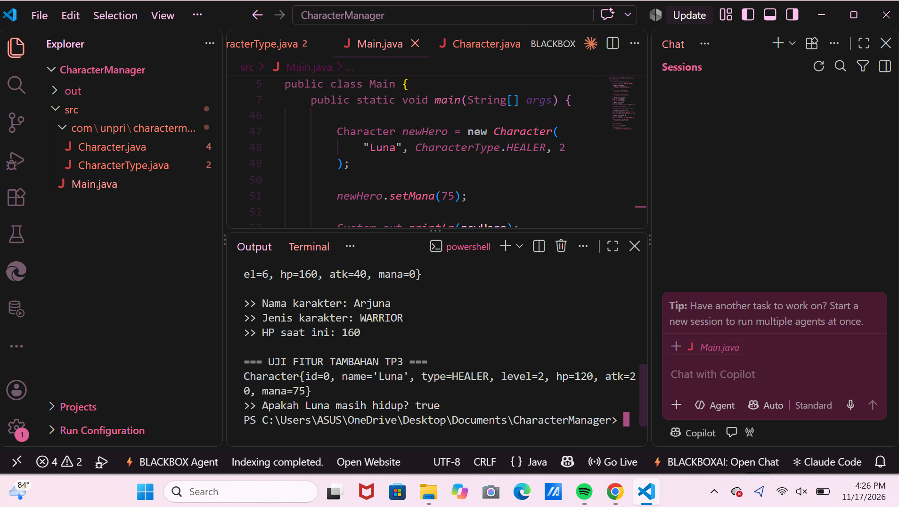

# Character Manager — TP3 (Java Visual SIH-6406)

## 1. Deskripsi
Character Manager merupakan aplikasi sederhana berbasis Java yang digunakan untuk mengelola dan menampilkan data karakter game. Proyek ini dibuat untuk memenuhi tugas TP3 mata kuliah Java Visual SIH-6406.

Aplikasi ini menerapkan konsep Object-Oriented Programming (OOP), khususnya Encapsulation, Constructor, Getter, Setter, dan Enum.

## 2. Fitur
- Membuat objek karakter menggunakan dua constructor.
- Menampilkan informasi karakter menggunakan toString().
- Mengubah level karakter menggunakan setLevel().
- Menghitung HP dan Attack Power secara otomatis.
- Mengatur Mana dengan validasi agar tidak bernilai negatif.
- Memeriksa status hidup karakter menggunakan isAlive().

## 3. Struktur Folder
```text
CharacterManager/
├── src/
│   ├── Main.java
│   └── com/
│       └── unpri/
│           └── charactermanager/
│               └── model/
│                   ├── Character.java
│                   └── CharacterType.java
├── out/
└── README.md
```

## 4. Hasil Program
Program berhasil dikompilasi dan dijalankan melalui Terminal menggunakan Java.

Program menampilkan tiga karakter utama, proses peningkatan level Arjuna, serta pengujian fitur tambahan berupa Mana dan isAlive().

**Screenshot hasil program:**


## 5. Identitas Mahasiswa
- Nama: Triyani Vianny
- NIM: 253303621278
- Mata Kuliah: Java Visual SIH-6406
- Tugas: TP3 — Character Manager Sprint #1
- Tanggal: 11 November 2027

## 6. Link Google Docs
https://docs.google.com/document/d/1dAGIkz2O9_-CEyK_-ONV9UVBErFjpvyR_64NC5E5m6I/edit?usp=sharing
