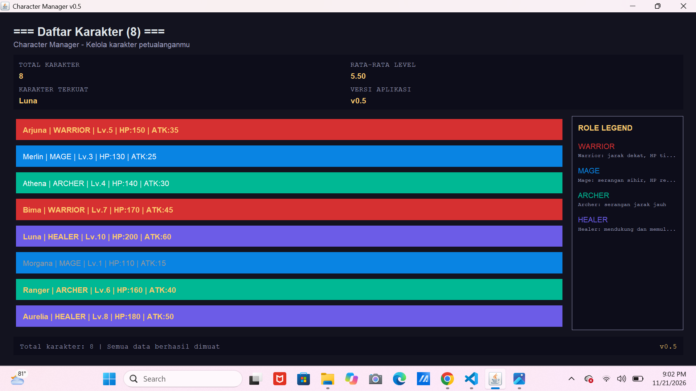
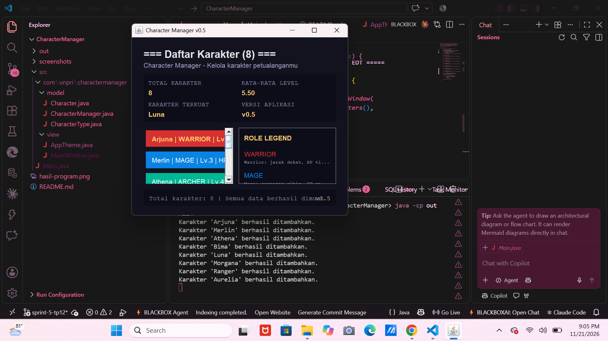

# Character Manager – Sprint 5 (TP12)

## Layout, UI Responsif & Analisis MVC

**Mata Kuliah:** Java Visual  
**CPMK:** 2  
**SCPMK:** 5  
**Sprint:** 5  
**Tugas:** TP12 – Character Manager Sprint #5  
**Versi Aplikasi:** v0.5

---

## 1. Deskripsi Proyek

Character Manager merupakan aplikasi berbasis Java yang dikembangkan menggunakan konsep Object-Oriented Programming (OOP) dan Graphical User Interface (GUI) dengan Java Swing.

Pada Sprint 5 ini, aplikasi dikembangkan dari versi 0.4 menjadi versi 0.5. Pengembangan berfokus pada penerapan Layout Manager, tampilan antarmuka responsif, penggunaan JScrollPane, panel bersarang, serta pemahaman pemisahan tanggung jawab berdasarkan prinsip Model-View-Controller (MVC).

## 2. Fitur yang Dikembangkan

1. Menggunakan BorderLayout sebagai layout utama.
2. Membagi tampilan menjadi empat wilayah, yaitu NORTH, CENTER, EAST, dan SOUTH.
3. Menampilkan daftar karakter menggunakan JScrollPane.
4. Menggunakan GridLayout untuk menyusun kartu karakter.
5. Menggunakan BoxLayout dengan arah Y_AXIS untuk legenda role.
6. Menampilkan legenda berdasarkan CharacterType.values().
7. Menambahkan panel statistik menggunakan GridLayout.
8. Menambahkan status bar dengan informasi di kiri dan versi v0.5 di kanan.
9. Menampilkan minimal delapan karakter dengan variasi role dan level.
10. Menguji perubahan ukuran jendela aplikasi.

## 3. Implementasi Layout

Aplikasi menggunakan BorderLayout sebagai layout utama dengan pembagian berikut:

| Wilayah | Komponen | Fungsi |
|---|---|---|
| NORTH | Header dan statistik | Menampilkan judul dan informasi statistik |
| CENTER | JScrollPane | Menampilkan daftar karakter |
| EAST | Role Legend | Menampilkan informasi role |
| SOUTH | Status Bar | Menampilkan status aplikasi dan versi |

Daftar karakter disusun menggunakan GridLayout pada panel pembungkus. Panel tersebut dimasukkan ke dalam JScrollPane agar pengguna tetap dapat melihat seluruh karakter ketika ukuran jendela diperkecil.

Legenda role menggunakan BoxLayout dengan arah Y_AXIS sehingga setiap role tersusun secara vertikal.

## 4. Panel Tambahan – Statistik

Pada Sprint 5 ditambahkan panel statistik menggunakan GridLayout(2, 2).

Panel ini menampilkan empat informasi:

1. Total karakter.
2. Rata-rata level.
3. Karakter terkuat.
4. Versi aplikasi.

GridLayout dipilih karena dapat menyusun empat informasi dalam baris dan kolom dengan ukuran sel yang seragam.

FlowLayout tidak dipilih karena susunan komponennya mengikuti aliran horizontal dan kurang sesuai untuk pembagian informasi statistik menjadi empat bagian yang teratur.

## 5. Mini-Challenge – Status Bar

Status bar menggunakan BorderLayout agar informasi dapat ditempatkan pada dua sisi berbeda.

- Bagian kiri menampilkan jumlah karakter dan status pemuatan data.
- Bagian kanan menampilkan versi aplikasi v0.5.

Dengan susunan ini, informasi status dan versi aplikasi dapat ditampilkan secara terpisah.

## 6. Data Karakter

Aplikasi menampilkan delapan karakter dengan variasi role dan level.

| Nama | Role | Level |
|---|---|---:|
| Arjuna | WARRIOR | 5 |
| Merlin | MAGE | 3 |
| Athena | ARCHER | 4 |
| Bima | WARRIOR | 7 |
| Luna | HEALER | 10 |
| Morgana | MAGE | 1 |
| Ranger | ARCHER | 6 |
| Aurelia | HEALER | 8 |

**Total karakter:** 8  
**Rata-rata level:** 5.50

## 7. Wireframe Aplikasi

Berikut gambaran struktur tampilan Character Manager v0.5.

~~~text
+------------------------------------------------------+
|                    HEADER (NORTH)                    |
|             Judul dan deskripsi aplikasi             |
|------------------------------------------------------|
|                  PANEL STATISTIK                     |
|       Total | Rata-rata | Terkuat | Versi             |
|------------------------------------------------------|
|                                    |                 |
|  DAFTAR KARAKTER (CENTER)          | ROLE LEGEND     |
|                                    | (EAST)          |
|  +--------------------------------+|                 |
|  | Arjuna - WARRIOR               || WARRIOR         |
|  +--------------------------------+| MAGE            |
|  | Merlin - MAGE                  || ARCHER          |
|  +--------------------------------+| HEALER          |
|  | Athena - ARCHER                ||                 |
|  +--------------------------------+|                 |
|  | ...                            ||                 |
|  +--------------------------------+|                 |
|          SCROLLBAR                 |                 |
|------------------------------------------------------|
|                  STATUS BAR (SOUTH)                   |
|       Total karakter                  v0.5            |
+------------------------------------------------------+
~~~

## 8. Hasil Pengujian Responsivitas

### A. Ukuran Awal

### B. Jendela Dilebarkan

### C. Jendela Dikecilkan Sampai Scrollbar Terlihat

## 9. Tabel Pengamatan Resize

| Kondisi | Prediksi | Hasil Pengamatan |
|---|---|---|
| Ukuran awal | Komponen tampil sesuai layout | Tampilan awal berhasil ditampilkan |
| Jendela dilebarkan | Area CENTER menyesuaikan ruang yang tersedia | Daftar karakter menjadi lebih lebar |
| Jendela dikecilkan | JScrollPane menyediakan scrollbar jika diperlukan | Scrollbar vertikal terlihat dan daftar dapat digulir |

Berdasarkan pengujian, JScrollPane membantu pengguna melihat daftar karakter ketika ruang tampilan menjadi terbatas. Pada ukuran yang sangat kecil, beberapa teks pada panel legenda dan status terlihat terpotong.

## 10. Struktur Panel Bersarang

Aplikasi menggunakan mainPanel sebagai panel utama dengan BorderLayout. Di dalamnya terdapat panel NORTH yang menampung header dan panel statistik. Bagian CENTER berisi JScrollPane yang membungkus panel daftar karakter dengan GridLayout, sedangkan bagian EAST berisi panel legenda menggunakan BoxLayout. Bagian SOUTH digunakan untuk status bar yang menampilkan informasi jumlah karakter dan versi aplikasi.

## 11. Alasan Pemilihan Layout

BorderLayout dipilih sebagai layout utama karena dapat membagi jendela menjadi beberapa wilayah dengan fungsi yang berbeda.

GridLayout dipilih untuk menyusun kartu karakter dan panel statistik karena menghasilkan susunan komponen yang teratur.

BoxLayout dipilih untuk legenda karena informasi role lebih mudah dibaca jika disusun secara vertikal.

FlowLayout tidak dipilih untuk daftar karakter karena kurang sesuai untuk susunan kartu vertikal yang konsisten.

setLayout(null) juga tidak digunakan karena posisi komponen harus ditentukan secara manual menggunakan setBounds(). Cara tersebut kurang fleksibel ketika ukuran jendela berubah.

## 12. Analisis MVC

Pengaturan layout ditempatkan pada package view karena layout berkaitan dengan cara komponen ditampilkan kepada pengguna.

Package model tetap bertanggung jawab mengelola data karakter dan logika aplikasi. Dengan pemisahan ini, perubahan tampilan dapat dilakukan tanpa harus mengubah class Character, CharacterType, atau CharacterManager.

## 13. Laporan Google Docs

Link laporan Google Docs TP12:

https://docs.google.com/document/d/1LmsSJdmB8EnrT9nsaCXm7r9r6BVrg9qcWpAxYOjutX0/edit?usp=sharing

---

## 14. Struktur Program

~~~text
CharacterManager/
|
|-- src/
|   |-- Main.java
|   |
|   |-- com/
|       |-- unpri/
|           |-- charactermanager/
|               |-- model/
|               |   |-- Character.java
|               |   |-- CharacterType.java
|               |   |-- CharacterManager.java
|               |
|               |-- view/
|                   |-- MainWindow.java
|                   |-- AppTheme.java
|
|-- screenshots/
|   |-- tp12-1-ukuran-awal.png
|   |-- tp12-2-ukuran-lebar.png
|   |-- tp12-3-ukuran-kecil.png
|
|-- README.md
~~~

## 15. Kesimpulan

Melalui Sprint 5 TP12, aplikasi Character Manager berhasil dikembangkan menjadi versi 0.5 dengan penerapan Layout Manager, panel bersarang, JScrollPane, legenda role, dan panel statistik.

Pengujian perubahan ukuran jendela menunjukkan bahwa penggunaan Layout Manager dan JScrollPane membantu mengatur tampilan aplikasi ketika ukuran jendela berubah.

Pengembangan ini juga memperkuat pemahaman mengenai pemisahan tanggung jawab Model dan View sehingga aplikasi lebih terstruktur dan mudah dikembangkan.

---

**Repository GitHub:**  
https://github.com/yanicantik16/JavaVisual-253303621278

**Branch:** `sprint-5-tp12`
